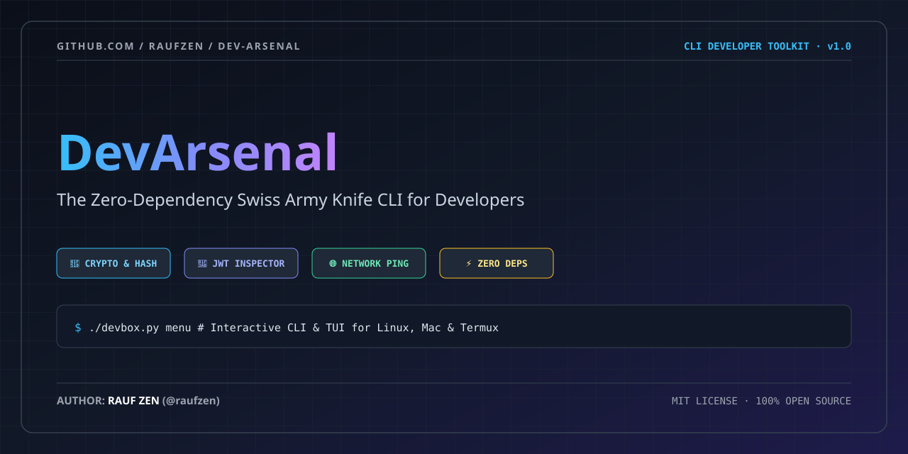

<div align="center">



# DevArsenal (devbox) ⚡

> **The Zero-Dependency Swiss Army Knife CLI & TUI for Developers & DevOps**

[](https://github.com/raufzen/dev-arsenal)
[](https://github.com/raufzen/dev-arsenal)
[](https://www.python.org/)
[-purple.svg)](#features)

Maintained by **[Rauf Zen](https://github.com/raufzen)**.

</div>

---

## 🚀 Overview

`devbox` is a standalone, lightweight, cross-platform CLI tool built entirely on the Python 3 standard library. It requires zero third-party packages and runs anywhere — on Linux, macOS, Windows, servers, and directly on Android via Termux or AntiGem.

---

## ⚡ Quick Start

```bash
# Clone the repository
git clone https://github.com/raufzen/dev-arsenal.git
cd dev-arsenal

# Run interactive terminal menu
./devbox.py menu
```

---

## 🛠️ Command Arsenal (18 Built-in Tools)

| Category | Command | Description | Example |
|---|---|---|---|
| **Crypto & Encoding** | `hash <text/file>` | Calculate MD5, SHA1, SHA256, SHA512 | `./devbox.py hash "secret"` |
| | `b64 <text> [-d]` | Base64 encode or decode string | `./devbox.py b64 "hello" -d` |
| | `jwt <token>` | Inspect and decode JWT payload & expiry | `./devbox.py jwt <token>` |
| **Dev Utilities** | `json <str/file>` | Format, beautify, and validate JSON | `./devbox.py json '{"a":1}'` |
| | `uuid [-n count]` | Generate random UUIDv4 identifiers | `./devbox.py uuid -n 5` |
| | `pass [-l len]` | Generate cryptographically secure passwords | `./devbox.py pass -l 24` |
| | `time [ts/now]` | Convert timestamp to UTC or get current epoch | `./devbox.py time now` |
| | `url <url>` | Parse URL components & query parameters | `./devbox.py url "https://site.com?q=1"` |
| | `regex <pat> <txt>`| Test regex patterns with colored highlights | `./devbox.py regex "\d+" "port 8080"` |
| | `color <#hex>` | Display 24-bit TrueColor swatch & RGB values | `./devbox.py color "#38bdf8"` |
| **Network & Web** | `ip` | Show public IP, local IP, and hostname | `./devbox.py ip` |
| | `dns <domain>` | Resolve DNS A/AAAA IP addresses | `./devbox.py dns "github.com"` |
| | `http <url>` | Measure HTTP status code and latency | `./devbox.py http github.com` |
| | `port <host> <port>`| Test TCP port reachability | `./devbox.py port 8.8.8.8 53` |
| | `serve [port]` | Instant local Wi-Fi file sharing HTTP server | `./devbox.py serve 8080` |
| **System & Audit** | `sys` | View system specs and disk space metrics | `./devbox.py sys` |
| | `du [dir]` | Analyze top 10 largest files in folder | `./devbox.py du .` |
| | `audit [dir]` | Scan directory for exposed secrets / API keys | `./devbox.py audit .` |

---

## 🧪 Unit Testing

Run the test suite across all modules:

```bash
python3 -m unittest discover -s tests
```

---

## 📄 License

Open-source and released under the [MIT License](LICENSE).
